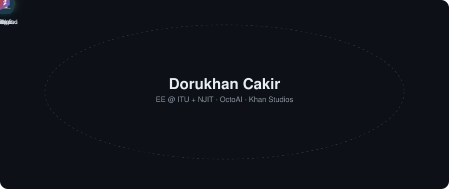

  

Hi, I'm Dorukhan. I'm a 4th-year Electrical Engineering student in the ITU-NJIT dual diploma program (Istanbul Technical University and New Jersey Institute of Technology), graduating in May 2027. I do research on machine learning for signals, build offline AI assistants under **OctoAI**, and make games as **Khan Studios**.

### Research

- **Calibrating Deep AMC Classifiers with SNR-Adaptive Temperature Scaling**, with Asmar Hasanova (equal contribution). **Best Oral Paper Award, Third Prize** at IEEE ISAIA 2026, IEEE North Jersey Section. A per-SNR temperature lowers calibration error by 27.1% at low SNR, without retraining the classifier. [Code and data](https://doi.org/10.5281/zenodo.19747126)
- **Multilingual Sign-to-Speech Communication Device** (senior design team project). Recognizes ASL from a camera and speaks it in English, Turkish or Spanish, fully offline on a Jetson Orin Nano. I work on the language and speech side. [Repo](https://github.com/anxious956/Multilingual-Sign-to-Speech-Communication-Device)
- **Multi-object tracking in microscopy** for automated sperm motility analysis (ongoing).

### OctoAI: offline AI assistants

| | |
|---|---|
| **Orion** | Voice assistant for Windows that runs on your own PC. Talk or type. [Download](https://github.com/Khan-Doruk/orion-releases/releases/latest) |
| **Iris** | Visual AI companion that looks at your screen, reads text and describes what it sees. [Download](https://github.com/Khan-Doruk/iris-releases/releases/latest) |
| **Atlas** | Research assistant that answers from your own documents and papers. [Download](https://github.com/Khan-Doruk/atlas-releases/releases/latest) |
| **DJ** | Voice-controlled music assistant, a personal build |

Free for Windows 10 and 11. Each app needs a product key to activate. More at [ai.octoman.io](https://ai.octoman.io)

### Khan Studios: games

| | |
|---|---|
| **Card Wars** | Strategy card game with online multiplayer. [Play on itch.io](https://khanstudios.itch.io/cards-wars) |
| **Cubing** | Parkour game. [Play on itch.io](https://khanstudios.itch.io/cubing) |
| **Cubing 2** | In development. [itch.io](https://khanstudios.itch.io/cubing-2) |

### Hardware

- **[Khan Nomad](https://github.com/Khan-Doruk/Khan-nomad)**: my fork of [Jcorp Nomad](https://github.com/Jstudner/jcorp-nomad), a pocket-sized offline media server on an ESP32-S3. I rebranded it, added a Turkish interface and am planning a Bluetooth music player.
